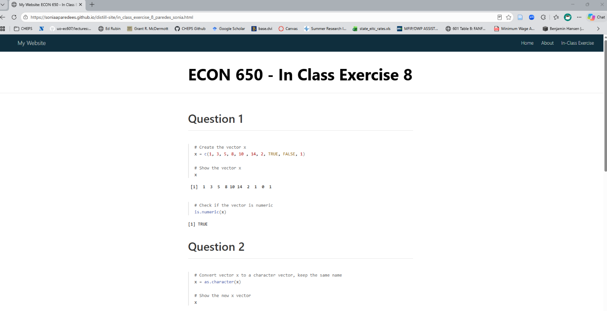
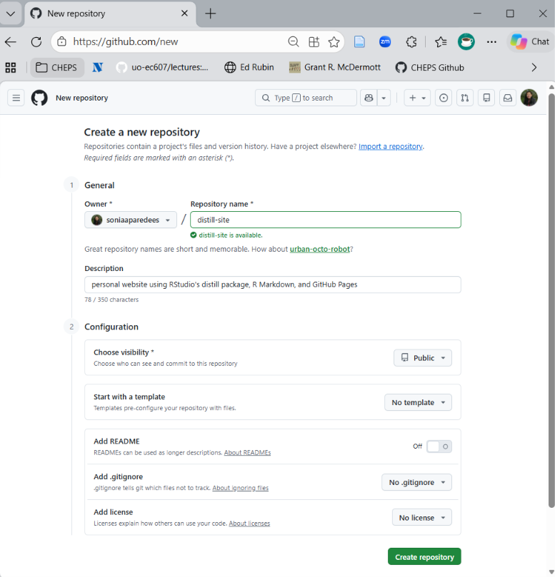
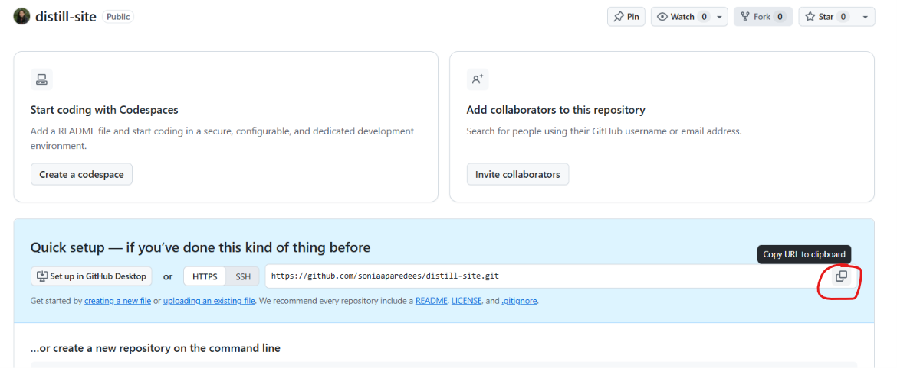
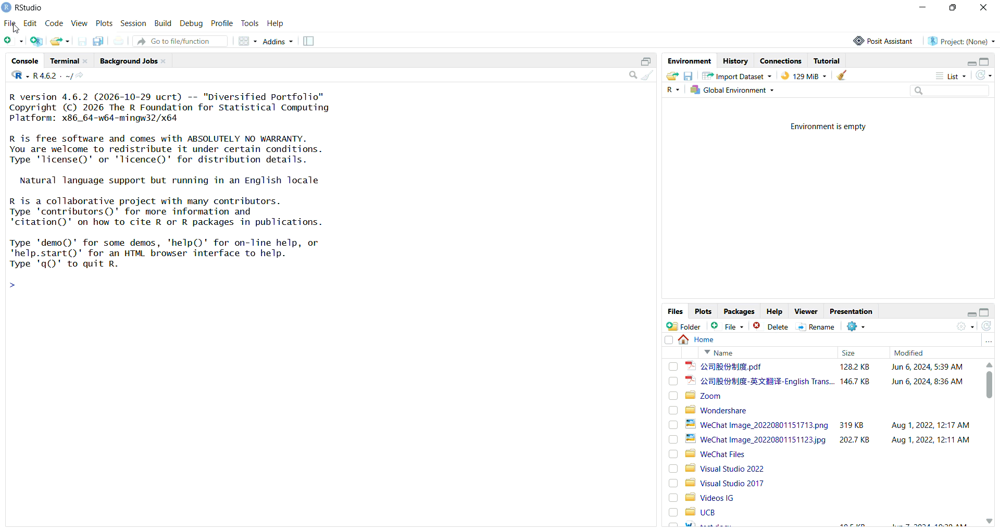

## What is `distill`?

`distill` is an RStudio package and a web publishing format optimized for scientific and technical communication [@allaire2018distill].

It is part of the R Markdown ecosystem for creating computational documents in R [@allaire2018distill].

## What can `distill` do?

- Reader-friendly typography for mobile devices
- LaTeX math, citations, and footnotes
- Flexible figure layouts and polished tables
- Support for diagrams, JavaScript, and interactive visualizations
- Tools for publishing articles and websites

## Why use `distill`?

- Keep authoring, analysis, and publishing in RStudio.
- Turn an existing R Markdown project into a website with relatively little extra work.
- Reduce the friction of documenting and presenting a data project.

## Example: From class exercise to webpage

An in-class R Markdown exercise can become a shareable webpage.

::: {.r-stretch}
<div class="single-image">
  
</div>
:::

## Why make a personal website?

A personal website is essentially a digital calling card.

- Showcase your work and interests
- Share projects with potential employers or academic colleagues
- Build a small, useful portfolio project

## How do websites work?

**Front end** = user-side: what visitors see and interact with, such as HTML and CSS [@geeksforgeeks2025frontend].

**Back end** = server-side: how a site stores and transfers data, including server requests, queries, and database connections [@geeksforgeeks2025frontend].

## Static or dynamic?

**Static website:** displays prebuilt content from rendered source code without server-side content processing. It can respond to user actions, but the underlying content cannot be updated in real time [@geeksforgeeks2025static].

**Dynamic website:** uses server-side processing and can update site information through a database connection [@geeksforgeeks2025static].

Static sites are a straightforward, low-cost way to publish information. Hosting options include GitHub Pages, Netlify, and Cloudflare Pages.

Limitations arise when a static webpage contains large amounts of data or requires frequent real-time updates.

## Today’s setup

- **Authoring:** RStudio
- **Website format:** Distill
- **Hosting:** GitHub Pages

GitHub Pages availability for private repositories depends on the GitHub plan and account. Public repositories are a common free option.

The following steps are drawn from Chapter 21 of the free online textbook [*rstudio4edu*](https://rstudio4edu.github.io/rstudio4edu-book/make-distill.html) [@deleon2019distill].

## What you need

- A GitHub account
- RStudio
- Git installed and configured

## Create a GitHub repository
1. Create a repository named `distill-website`, or choose another name.
2. Leave the initialization options unchecked; a README can be added later.
::: {.r-stretch}
<div class="single-image">
  
</div>
:::

## Copy the repository URL
::: {.r-stretch}
<div class="single-image">
  
</div>
:::

## Create an R project with the repository in RStudio

1. Select **File → New Project → Version Control → Git**.
2. Paste the repository URL and choose a local directory.

::: {.r-stretch}
<div class="single-image">
  
</div>
:::

## Install and load the `distill` package

Once the project is initialized, install and load the `distill` package by running the following code in the console.

```{r, eval = FALSE, echo = TRUE}
install.packages("distill")
library(distill)
```

Make sure your R version is up to date. An outdated version may cause problems when rendering the site.

## Create the website template

In the RStudio Console, run:

```{r, eval = FALSE, echo = TRUE}
distill::create_website(dir = getwd(), gh_pages = TRUE)
```

## Render and preview

1. Close your current R session and reopen RStudio using the new project.
2. Select **Build Website** in the newly appeared Build pane.
3. Preview the rendered site in RStudio’s HTML viewer.

::: {.r-stretch}
<div class="single-image">
  
</div>
:::

## Commit and push

1. In the Git pane, stage the files you want to publish.
2. Commit with a descriptive message.
3. Push the commit to GitHub.

::: {.r-stretch}
<div class="single-image">
  
</div>
:::

## Configure GitHub Pages and deploy

1. Open the repository’s **Settings → Pages**.
2. Under **Build and deployment**, choose **Deploy from a branch**.
3. Select the `main` branch and `/docs` folder, then save.
4. Open the repository’s **Actions** tab and check the Pages deployment workflow.

The site URL is typically: `<username>.github.io/<repository-name>`

::: {.r-stretch}
<div class="single-image">
  
</div>
:::

## Make it your own

- Update the content, navigation, and design.
- Try templates from other packages, such as `postcards`.
- Add your own R Markdown documents and HTML outputs in RStudio.
- Commit and push your changes when ready; GitHub Pages will automatically update your site.

## Other useful resources

- [rstudio4edu](https://rstudio4edu.github.io/rstudio4edu-book/make-distill.html)
- [Distill package documentation](https://cran.r-project.org/web/packages/distill/index.html)
- [Distill RStudio package webpage](https://pkgs.rstudio.com/distill/index.html)
- [Distill RStudio GitHub site](https://rstudio.github.io/distill/)

## References

::: {#refs}
:::
